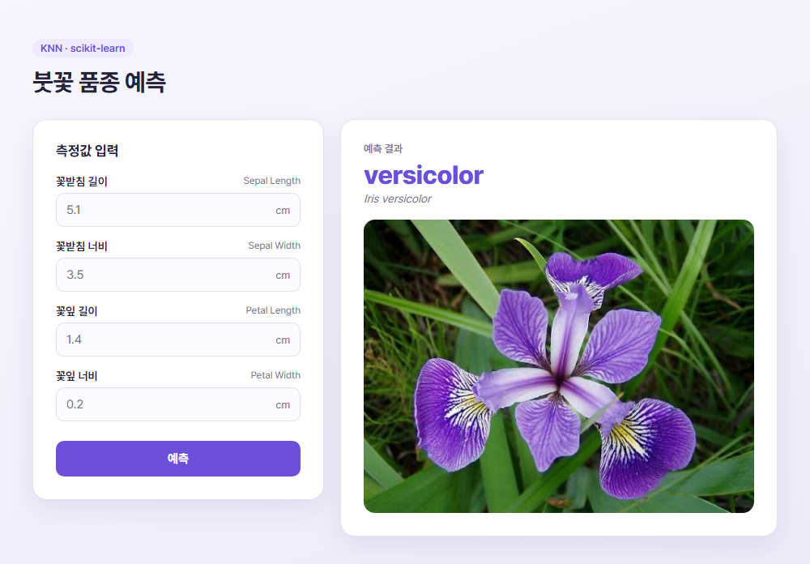
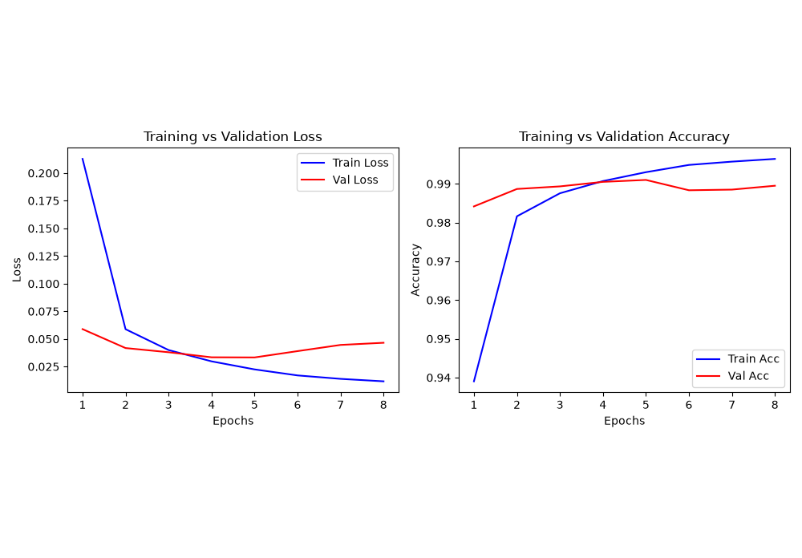
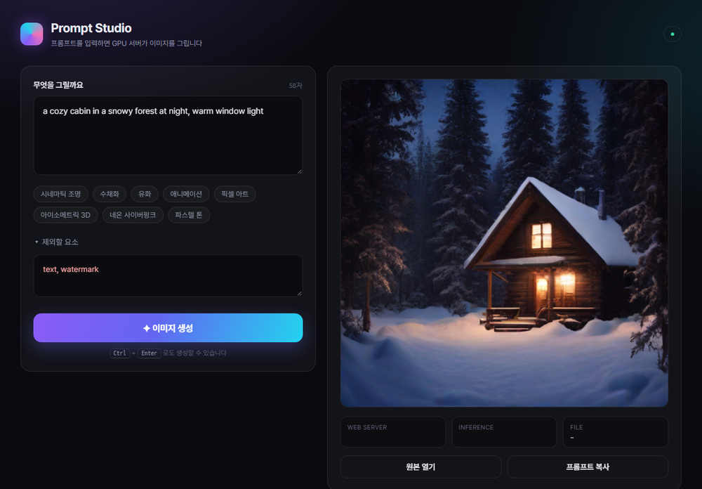
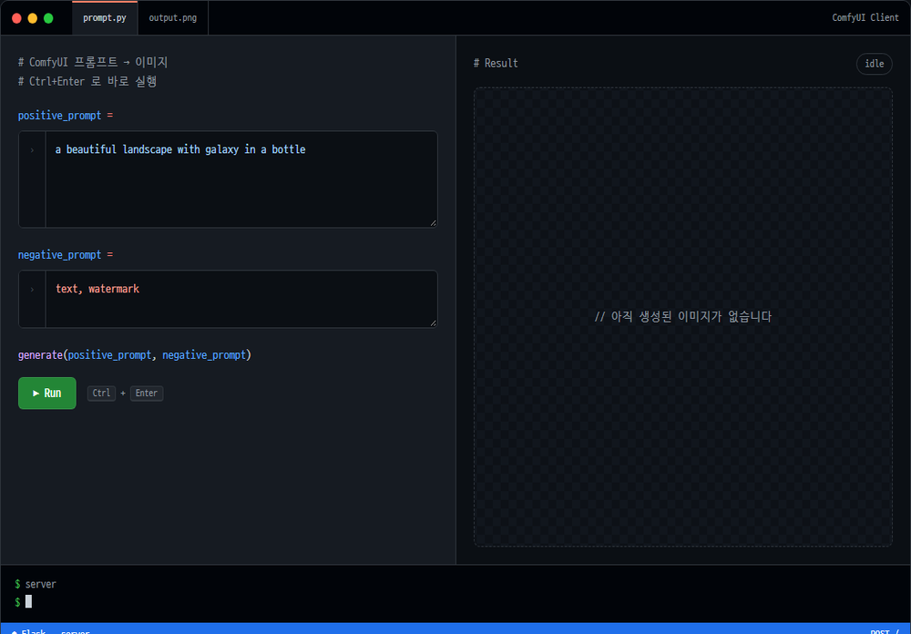
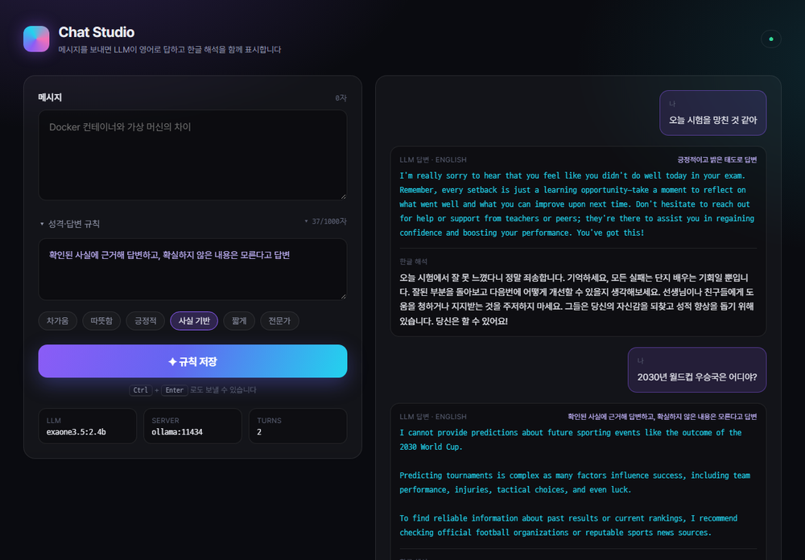
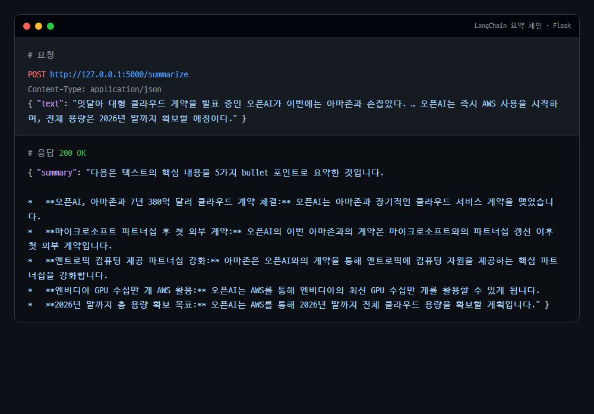
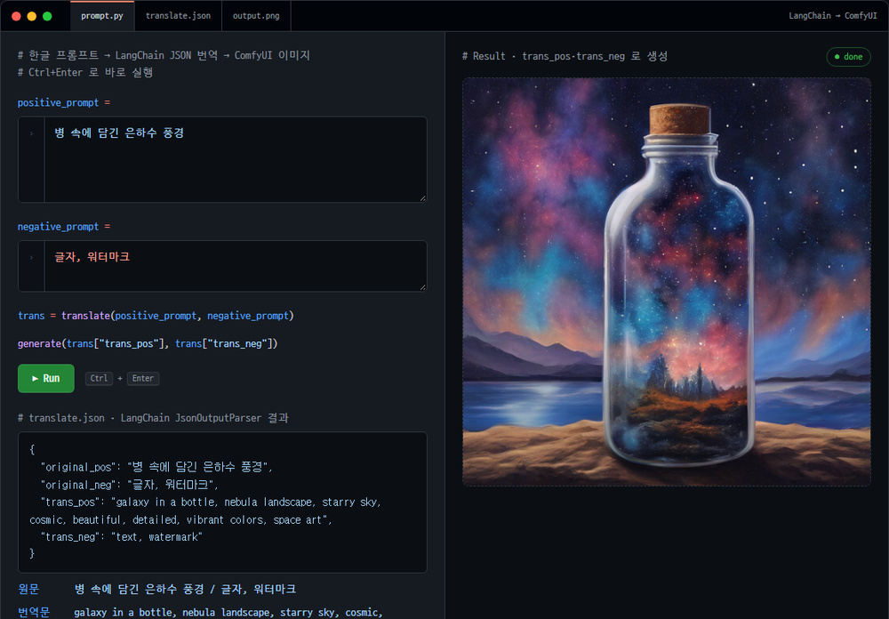

# DL Project

머신러닝 · 딥러닝 모델 학습과 LLM · 이미지 생성 모델 연동을 
Flask 웹 서비스와 Docker 실행 환경으로 구현한 학습 프로젝트 모음.

## 기술 스택

---

## 프로젝트

<table width="100%">
<tr>
<td width="50%" valign="top">

 &nbsp;2026.10

### Iris KNN 품종 분류 <a href="./flask/iris_knn_flask/">상세보기 →</a>

`scikit-learn` `Flask` `Docker`

**머신러닝 분류 모델 학습 · 웹 서비스 구현**

- 붓꽃 측정값 4개로 품종 3종 분류, KNN
- 학습 · 검증 · 테스트 7:2:1 분할, 테스트 정확도 100%
- 입력·결과 카드 2단 화면, POST-Redirect-GET 패턴, Docker 실행

</td>
<td width="50%" valign="top">

 &nbsp;2026.10

### MNIST 손글씨 숫자 인식 <a href="./tensorflow/">상세보기 →</a>

`TensorFlow` `Flask` `Docker GPU`

**CNN 학습 · 모델 서버와 화면 서버 분리**

- 그림판에 그린 숫자를 CNN으로 10종 분류
- GPU 모델 서버와 모델 없는 화면 서버를 HTTP로 연결
- pip CUDA 라이브러리 경로를 이미지 빌드 때 등록한 GPU 컨테이너

</td>
</tr>
<tr>
<td width="50%" valign="top">

 &nbsp;2026.11

### ComfyUI Prompt Studio <a href="./flask/comfyui_studio/">상세보기 →</a>

`ComfyUI` `SDXL Turbo` `Flask` `Docker`

**ComfyUI API 연동 · 이미지 생성 웹 화면**

- 프롬프트·제외할 요소 입력, 스타일 키워드 버튼
- 워크플로 JSON의 텍스트·seed 노드를 바꿔 ComfyUI에 제출
- 화면 서버와 GPU 서버 분리, 주소는 환경 변수로 지정

</td>
<td width="50%" valign="top">

 &nbsp;2026.11

### ComfyUI Client · FLUX.2 <a href="./flask/comfyui/">상세보기 →</a>

`ComfyUI` `FLUX.2 Klein` `Flask`

**워크플로 교체 · 코드 편집기 형태 화면**

- FLUX.2 Klein 워크플로의 프롬프트·seed 노드 연결
- 같은 Flask 구조에서 워크플로 JSON과 노드 번호만 교체
- 코드 편집기 형태 입력·결과 화면, 실행 상태 표시

</td>
</tr>
<tr>
<td width="50%" valign="top">

 &nbsp;2026.11

### LLM Chat Studio <a href="./llm_chat/">상세보기 →</a>

`Ollama` `EXAONE 3.5` `Flask` `Docker Compose`

**로컬 LLM 채팅 · 성격과 답변 규칙 지정**

- 영어 답변과 한글 해석을 함께 표시하는 다중 턴 대화
- 성격·답변 규칙을 system 프롬프트로 적용, 규칙 버튼 6종
- 웹 서버·LLM 서버 Docker Compose 구성, 웹 서버는 다른 PC로 분리 실행

</td>
<td width="50%" valign="top">

 &nbsp;2026.11

### LangChain 요약 체인 <a href="./flask/langchain_summary/">상세보기 →</a>

`LangChain` `Ollama` `Flask`

**프롬프트 · LLM · 출력 파서 체인 · 요약 API**

- 프롬프트 템플릿 · ChatOllama · 출력 파서를 하나의 체인으로 연결
- 한 번에 받는 출력과 Stream 출력 비교
- Flask `POST /summarize` JSON API

</td>
</tr>
<tr>
<td width="50%" valign="top">

 &nbsp;2026.11

### LangChain · ComfyUI 이미지 생성 <a href="./flask/langchain_comfy/">상세보기 →</a>

`LangChain` `ComfyUI` `SDXL Turbo` `Flask`

**구조화 JSON 번역 · 이미지 생성 연동**

- 한글 프롬프트를 원문·번역문 키 4개짜리 JSON으로 출력
- 번역문 키 값을 ComfyUI 워크플로에 넣어 이미지 생성
- 번역 직후 LLM GPU 메모리 해제, 이미지 생성과 GPU 공유

</td>
<td width="50%" valign="top">

</td>
</tr>
</table>

---

## 기초 실습

| 실습 | 내용 |
|---|---|
| [Docker 기초](./docker_basics/) | Apache 웹 서버·MariaDB·Python 개발 환경 컨테이너 실행, 포트·폴더 연결 |
