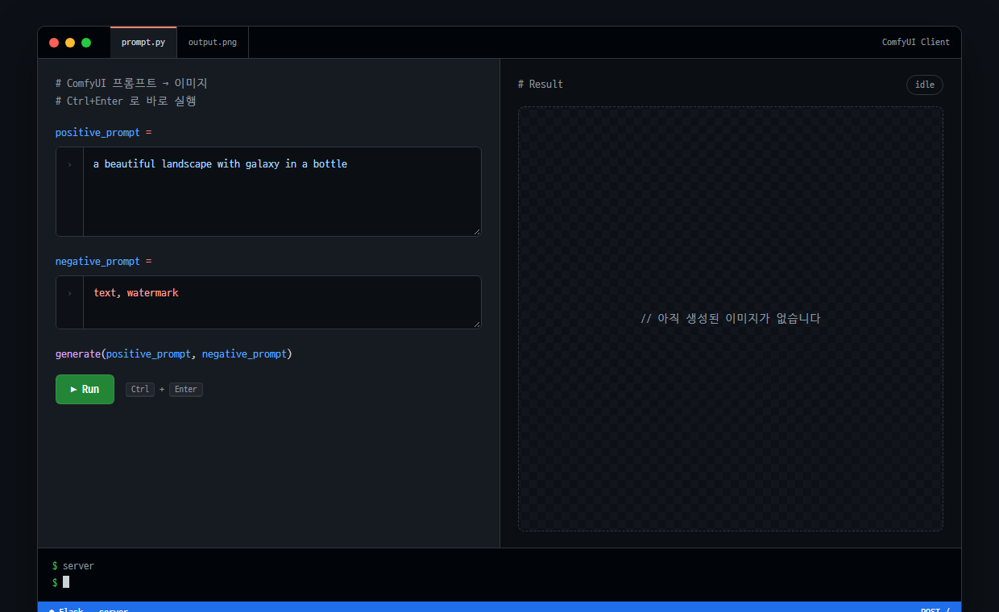

# ComfyUI Client · FLUX.2 워크플로

## 개요

- 코드 편집기 형태의 프롬프트 입력 화면에서 ComfyUI로 이미지 생성
- FLUX.2 Klein[^1] 워크플로의 프롬프트 노드와 seed 노드 값을 바꿔 GPU 서버에 제출
- 같은 Flask 구조로 워크플로 JSON과 노드 번호만 바꿔 다른 모델에 연결

[^1]: FLUX.2 Klein: Black Forest Labs의 이미지 생성 모델, 이 워크플로는 4B 기본 모델과 Qwen3 4B 텍스트 인코더 사용

## 사용 기술


## 실행 화면



## 워크플로 연결

| 노드 | 종류 | 바꾸는 값 |
|---|---|---|
| `76` | PrimitiveStringMultiline | positive 프롬프트 |
| `75:67` | CLIPTextEncode | negative 프롬프트 |
| `75:73` | RandomNoise | 실행마다 무작위 seed |

- 생성 크기 1024×1024, 20단계, CFG 5
- 필요한 모델 파일: `flux-2-klein-base-4b.safetensors`, `qwen_3_4b.safetensors`, `flux2-vae.safetensors`
- `static/test.json`은 SDXL Turbo 워크플로, `WORKFLOW_PATH`와 노드 번호를 바꾸면 같은 화면에서 사용 가능

## 파일별 기능

- `app.py`: Flask 라우트, 워크플로 읽기, FLUX.2 노드 값 교체, ComfyUI 제출과 완료 확인, 이미지 주소 생성
- `templates/image.html`: 코드 편집기 형태 입력·결과 화면, 실행 상태 표시
- `static/flux2.json`: FLUX.2 Klein 워크플로
- `static/test.json`: SDXL Turbo 워크플로
- `requirements.txt`: 실행 패키지 목록

## 실행 방법

FLUX.2 Klein 모델이 설치된 ComfyUI 서버 필요

```bash
pip install -r requirements.txt
COMFY_URL=http://<ComfyUI 서버 IP>:8188 python app.py
```

브라우저 접속: `http://localhost:5000/`
