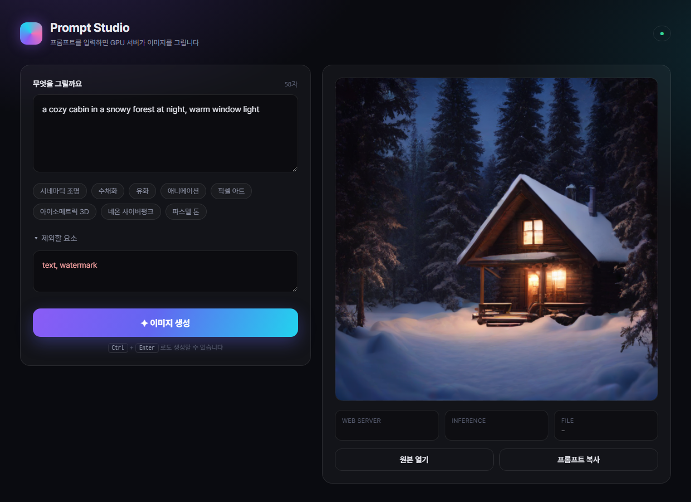

# ComfyUI Prompt Studio

## 개요

- 영어 프롬프트 입력 웹 화면에서 ComfyUI로 이미지 생성
- Flask 서버가 ComfyUI API에 워크플로를 제출하고 완료 결과를 받아 화면에 표시
- 스타일 키워드 버튼, 제외할 요소 입력, 생성 시간 표시, 원본 열기·프롬프트 복사
- 화면 서버와 GPU 서버 분리: 화면 서버는 모델 없이 ComfyUI 주소로 요청만 전달

## 사용 기술


## 실행 화면



## 동작 흐름

```text
브라우저 ── POST positive·negative ──▶ Flask 화면 서버
                                        │
                                        ├─ 1. static/test.json 워크플로 읽기
                                        ├─ 2. 6번 positive · 7번 negative 노드에 입력, 13번 seed 무작위
                                        ├─ 3. ComfyUI /prompt 제출 ──▶ GPU 서버: SDXL Turbo
                                        ├─ 4. /history/{prompt_id} 1초 간격 완료 확인
                                        └─ 5. 첫 번째 출력 이미지의 /view 주소를 화면에 표시
```

- ComfyUI 워크플로는 API 형식 JSON 그대로 저장하고, 실행할 때 텍스트·seed 값만 교체
- 생성 이미지는 브라우저가 ComfyUI `/view` 주소에서 받으므로, 브라우저에서 ComfyUI 주소에 접속 가능해야 함

## 파일별 기능

- `app.py`: Flask 라우트, 워크플로 읽기, 프롬프트·seed 교체, ComfyUI 제출과 완료 확인, 이미지 주소 생성
- `templates/image.html`: Prompt Studio 화면, 스타일 키워드 버튼, 생성 중 표시, 원본 열기·프롬프트 복사
- `static/test.json`: SDXL Turbo 1단계 생성 워크플로, 512×512
- `requirements.txt`: 실행 패키지 목록
- `Dockerfile`: 화면 서버 이미지

## 실행 방법

### 준비

- ComfyUI 서버와 `sd_xl_turbo_1.0_fp16.safetensors` 모델
- ComfyUI 주소는 환경 변수 `COMFY_URL`

### 로컬 실행

```bash
pip install -r requirements.txt
COMFY_URL=http://<ComfyUI 서버 IP>:8188 python app.py
```

### Docker 실행

```bash
docker build -t comfyui-studio .
docker run -d --name comfyui-studio -p 5000:5000 -e COMFY_URL=http://<ComfyUI 서버 IP>:8188 comfyui-studio
```

브라우저 접속: `http://localhost:5000/`
