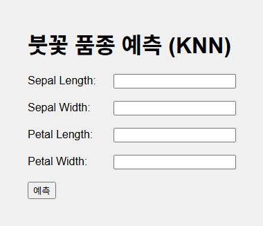
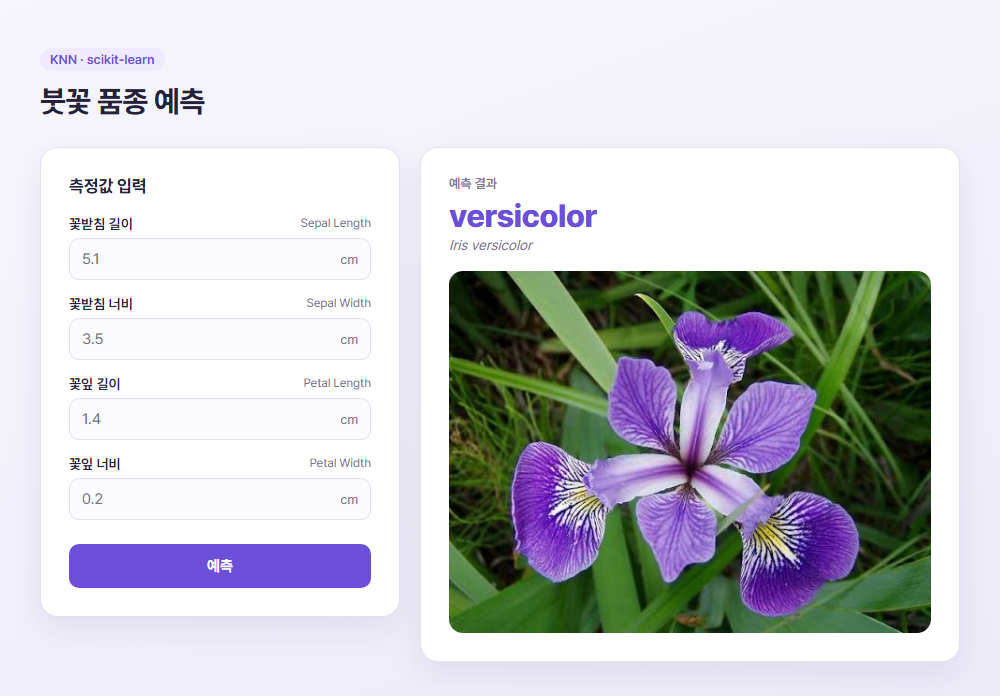
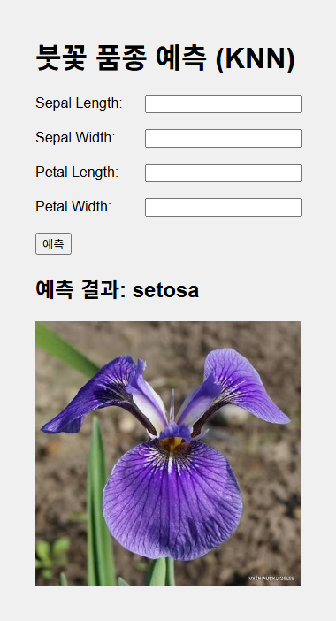
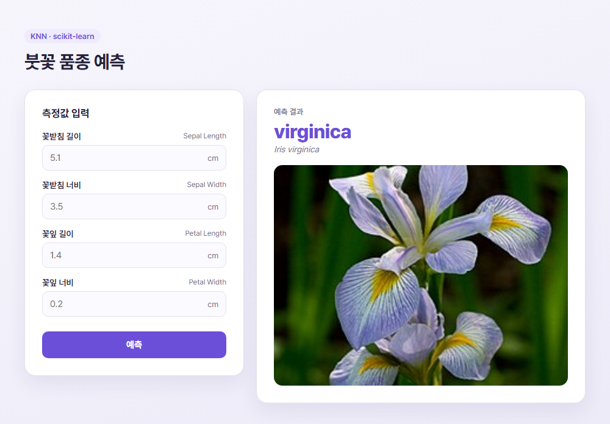

# Iris KNN Flask

## 개요

- Iris 데이터셋 기반 붓꽃 품종 3종 분류
- KNN 분류 모델 학습과 저장
- Flask 웹 화면에서 측정값 입력 후 품종 예측
- 예측 품종 이름과 품종 사진 출력
- POST-Redirect-GET 패턴 적용, 새로고침 시 같은 입력 재전송 방지
- 입력 카드와 결과 카드 2단 화면, 모바일 폭에서 1단 배치
- Docker 컨테이너 실행 환경

## 사용 기술


## 입력 항목

- 꽃받침 길이: `Sepal Length`
- 꽃받침 너비: `Sepal Width`
- 꽃잎 길이: `Petal Length`
- 꽃잎 너비: `Petal Width`
- 입력 단위: `cm`

## 예측 대상

- `setosa`
- `versicolor`
- `virginica`

## 실행 화면

### 입력 화면

- 항목별 한글·영문 이름과 cm 단위 표시
- 측정값 4개 입력 후 예측 버튼 실행



### 예측 결과

- 예측 품종 이름, 학명, 품종 사진 출력



<div align="center">
  
  
</div>

| 예측 결과 | Sepal Length | Sepal Width | Petal Length | Petal Width |
|:---:|:---:|:---:|:---:|:---:|
| setosa | 5.1 | 3.5 | 1.4 | 0.2 |
| versicolor | 6.0 | 2.9 | 4.5 | 1.5 |
| virginica | 6.9 | 3.1 | 5.4 | 2.1 |

## 모델 구성

- 알고리즘: KNN, `KNeighborsClassifier`
- 이웃 수: `3`
- 데이터 분할: 학습 105개 · 검증 30개 · 테스트 15개, 7:2:1, 품종 비율 유지
- 정확도: 검증 93.3% · 테스트 100%
- 입력값: 측정값 4개
- 출력값: 품종 3개
- 모델 파일: `model/iris_model.pkl`

## 파일별 기능

- `app.py`: 모델 불러오기, 품종 예측, 결과를 session에 담아 redirect 후 출력
- `train_model.py`: 데이터 7:2:1 분할, KNN 학습, 모델 저장
- `templates/index.html`: 입력 카드와 결과 카드 화면, 입력 오류 표시
- `static/style.css`: 화면 스타일, 모바일 폭 1단 배치
- `static/`: 품종별 사진
- `static/images/`: 실행 화면 캡처
- `requirements.txt`: 실행 패키지 목록
- `Dockerfile`: Python 3.12 환경, 패키지 설치, 소스코드·모델 복사, 5000 포트 실행

## 프로젝트 구조

```text
iris_knn_flask/
├─ app.py
├─ train_model.py
├─ requirements.txt
├─ Dockerfile
├─ README.md
├─ model/
│  └─ iris_model.pkl
├─ templates/
│  └─ index.html
└─ static/
   ├─ style.css
   ├─ setosa.jpg
   ├─ versicolor.jpg
   ├─ Iris_virginica_2.jpg
   └─ images/
      ├─ input_screen.png
      ├─ result_setosa.png
      ├─ result_versicolor.png
      └─ result_virginica.png
```

## 처리 과정

- Iris 데이터셋 150개 불러오기
- 학습 · 검증 · 테스트 7:2:1 분할
- KNN 모델 학습과 저장
- Flask 앱 실행, 저장 모델 불러오기
- 측정값 4개 POST 요청
- 품종 예측, 품종 이름과 사진 파일 결정
- 결과를 session에 저장 후 GET 주소로 redirect
- 결과 한 번 출력 후 session에서 삭제

## 실행 방법

### Docker 실행

Docker만 설치된 환경에서 Python·패키지 설치 없이 실행

```bash
git clone https://github.com/seo941024/DL_project.git
cd DL_project/flask/iris_knn_flask
docker build -t iris-knn-flask .
docker run -d --name iris-knn-flask -p 5000:5000 iris-knn-flask
```

브라우저 접속:

```text
http://127.0.0.1:5000/
```

### 로컬 실행

`iris_knn_flask` 폴더에서 실행

```bash
pip install -r requirements.txt
python app.py
```

### 모델 다시 학습

```bash
python train_model.py
```
