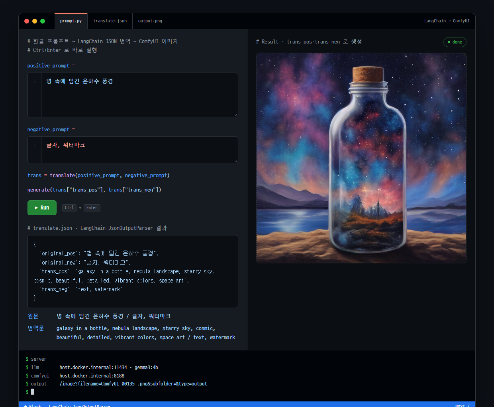

# LangChain 구조화 번역 · ComfyUI 이미지 생성

## 개요

- 한글 positive · negative 프롬프트 입력 웹 화면
- LangChain `JsonOutputParser`로 원문과 영어 번역문을 키 4개짜리 JSON으로 출력
- JSON의 `trans_pos` · `trans_neg` 값을 ComfyUI 워크플로에 넣어 이미지 생성
- 원문 · 번역문 · JSON · 생성 이미지를 한 화면에 표시

## 사용 기술


## 동작 흐름

```text
브라우저 ── POST 한글 positive · negative ──▶ Flask
                                              │
                                              ├─ 1. LangChain 체인
                                              │      ChatPromptTemplate + format_instructions
                                              │      → ChatOllama gemma3:4b → JsonOutputParser
                                              │      ◀── {"original_pos", "original_neg", "trans_pos", "trans_neg"}
                                              │
                                              ├─ 2. ComfyUI /prompt
                                              │      trans_pos → 6번 노드, trans_neg → 7번 노드, seed 무작위
                                              │      ◀── /history 완료 확인
                                              │
                                              └─ 3. /image 경로로 생성 이미지 전달 ──▶ 브라우저
```

- 출력 형식은 Pydantic 클래스 `PromptPair`로 정의, `get_format_instructions()` 결과를 프롬프트에 넣어 키 이름과 형식 지정
- `original_*`는 입력 원문 그대로, `trans_*`는 쉼표로 구분한 영어 키워드
- LLM은 번역 직후 GPU 메모리에서 해제 `keep_alive=0`, 이어지는 ComfyUI 이미지 생성과 GPU 메모리 공유
- 생성 이미지는 Flask `/image` 경로가 ComfyUI `/view`를 대신 받아 전달, 브라우저의 ComfyUI 주소 접속 불필요

## 실행 화면



```json
{
  "original_pos": "병 속에 담긴 은하수 풍경",
  "original_neg": "글자, 워터마크",
  "trans_pos": "galaxy in a bottle, nebula landscape, starry sky, cosmic, beautiful, detailed, vibrant colors, space art",
  "trans_neg": "text, watermark"
}
```

## 문제 해결

| 구분 | 내용 |
|---|---|
| 문제 | `original_pos`에 한글 원문 대신 영어 번역이 들어간 JSON 출력 |
| 원인 | 키 설명이 "원문 그대로"뿐이라 LLM이 원문 칸까지 번역 |
| 해결 | 프롬프트와 `PromptPair` 키 설명에 "번역하지 말고 입력 언어 그대로 복사" 명시 |
| 결과 | 한글 프롬프트 8건 모두 원문 일치, 키 4개 출력 |

## 파일별 기능

- `app.py`: Flask 라우트, LangChain 구조화 출력 체인, ComfyUI 워크플로 제출 · 완료 조회 · 이미지 전달
- `templates/index.html`: 코드 편집기 형태 입력 화면, JSON 결과, 원문 · 번역문, 생성 이미지
- `static/workflow.json`: ComfyUI SDXL Turbo 워크플로, 6번 positive · 7번 negative · 13번 seed 노드
- `requirements.txt`: 실행 패키지 목록

## 실행 방법

### 준비

- Ollama 서버와 `gemma3:4b` 모델
- ComfyUI 서버와 `sd_xl_turbo_1.0_fp16.safetensors` 모델
- 서버 주소는 환경 변수 `OLLAMA_URL` · `COMFY_URL`, 기본값은 Docker 컨테이너 안에서 PC를 가리키는 `host.docker.internal`

```bash
pip install -r requirements.txt
python app.py
```

브라우저 접속: `http://localhost:5000/`

다른 PC의 ComfyUI 사용 시

```bash
COMFY_URL=http://<ComfyUI 서버 IP>:8188 python app.py
```
