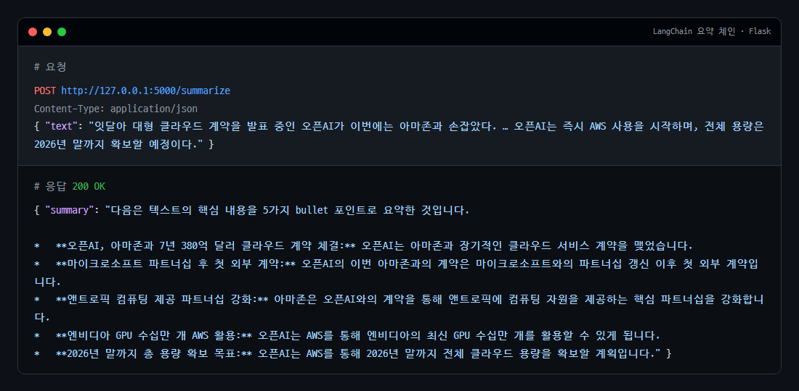

# LangChain 요약 체인 · Flask API

## 개요

- LangChain으로 프롬프트 · LLM · 출력 파서를 하나의 체인으로 연결
- Ollama `gemma3:4b`[^1]로 한국어 텍스트를 핵심 5줄로 요약
- 같은 체인을 콘솔 프로그램과 Flask `POST /summarize` API로 실행
- 한 번에 받는 출력과 토큰이 생성되는 대로 받는 Stream 출력 비교

[^1]: Gemma 3 4B: Google의 오픈 LLM, Ollama 모델 이름 `gemma3:4b`

## 사용 기술


## 체인 구성

```text
{"content": 텍스트} ──▶ ChatPromptTemplate ──▶ ChatOllama ──▶ StrOutputParser ──▶ 요약 문자열
                        "핵심 bullet 5개로      gemma3:4b       응답 메시지에서
                         한국어 요약해줘"        temperature 0.2  글자만 추출
```

- `chain = PROMPT | llm | StrOutputParser()`: 세 단계를 `|`로 연결한 LangChain 체인
- `chain.invoke(...)`: 요약 전체를 한 번에 반환
- `chain.stream(...)`: 생성되는 토큰 조각을 차례로 반환
- 낮은 temperature 0.2로 요약 문장의 일관성 유지

## 실행 결과



- 기사 본문을 `{"text": ...}`로 보내면 `{"summary": ...}`로 핵심 5줄 반환
- `text`가 비어 있으면 400 응답과 안내 문구 반환

## 파일별 기능

- `hello.py`: system · human 메시지 템플릿으로 한 줄 자기소개를 받는 가장 작은 체인
- `summarize_chain.py`: 텍스트 파일을 읽어 요약, Stream 출력, 다른 파일에서 `summarize_text` 함수로 재사용
- `app.py`: Flask 서버, 서버 시작 때 체인 1회 구성, `POST /summarize` JSON 요청 처리
- `requirements.txt`: 실행 패키지 목록

## 실행 방법

### 준비

- Ollama 서버와 `gemma3:4b` 모델
- 코드의 `base_url`은 Docker 컨테이너 안에서 PC의 Ollama를 부르는 주소 `http://host.docker.internal:11434`, 컨테이너 없이 실행하면 `http://localhost:11434`로 변경

```bash
ollama pull gemma3:4b
pip install -r requirements.txt
```

### 콘솔 체인

```bash
python hello.py
python summarize_chain.py 요약할_글.txt
```

### Flask API

```bash
python app.py
```

`POST http://127.0.0.1:5000/summarize`, Body raw JSON `{"text": "요약할 글"}`

PowerShell 요청 예시

```powershell
$body = @{ text = "요약할 글" } | ConvertTo-Json
(Invoke-RestMethod -Uri http://127.0.0.1:5000/summarize -Method Post -ContentType "application/json; charset=utf-8" -Body ([Text.Encoding]::UTF8.GetBytes($body))).summary
```
