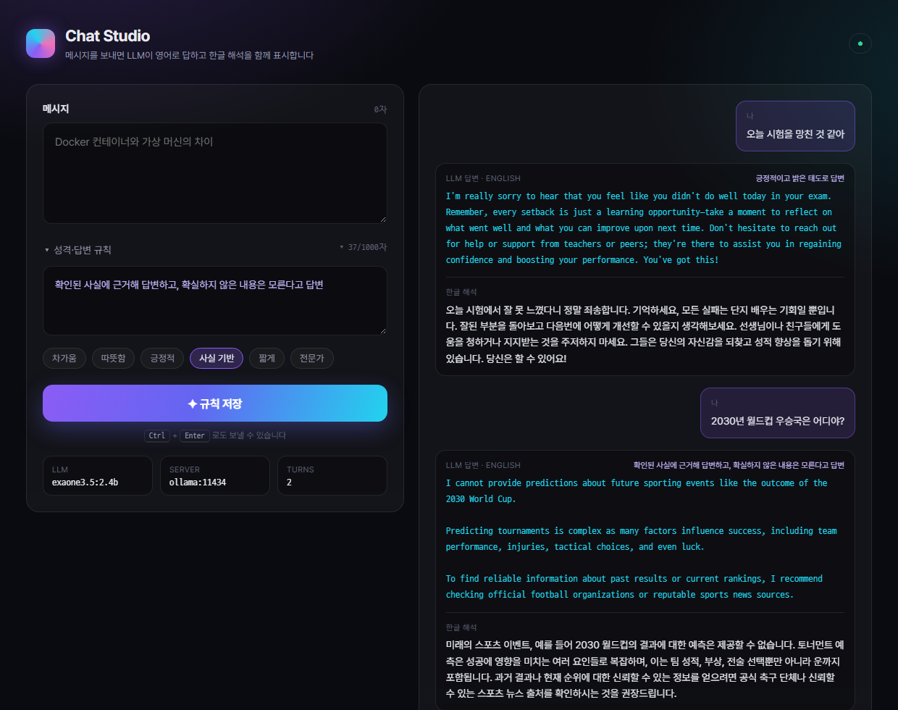

# LLM Chat Studio

## 개요

- 한글·영어 메시지 입력 웹 채팅 화면
- Ollama LLM의 영어 답변 생성
- 영어 답변의 한글 해석 생성
- 영어 답변과 한글 해석 동시 표시, 이전 대화를 이어 받는 다중 턴 대화
- 성격·답변 규칙 입력 칸, 말투와 답변 방식 지정
- 웹 서버·LLM 서버를 Docker Compose로 구성

## 실행 화면



- 대화마다 적용된 성격·답변 규칙 표시: 긍정적 태도 규칙은 응원하는 답변, 사실 기반 규칙은 미래 예측 거절

## 사용 기술


## 동작 흐름

```text
브라우저 ── POST 메시지 + 성격·답변 규칙 ──▶ web: Flask
                                              │
                                              ├─ 1. /api/chat ──▶ ollama: EXAONE 3.5 2.4B
                                              │      system: 기본 지시 + 성격·답변 규칙
                                              │      ◀── 영어 답변
                                              │
                                              ├─ 2. /api/chat ──▶ ollama: EXAONE 3.5 2.4B
                                              │      system: 번역 지시, 영어 답변만 전달
                                              │      ◀── 한글 해석
                                              │
                                              └─ 3. redirect 후 대화 화면 ──▶ 브라우저
```

- LLM: EXAONE 3.5 2.4B[^1], 한국어·영어 이중 언어 모델, 한자·가나가 섞이지 않는 한글 해석
- 1단계 요청에 이전 대화 최대 10턴 포함, 앞선 대화 맥락을 이어 가는 답변
- 대화 기록과 성격·답변 규칙은 웹 서버 메모리에 보관, 브라우저 session에는 대화 ID만 저장
- POST-Redirect-GET 패턴, 새로고침 시 같은 메시지 재전송 방지

[^1]: EXAONE 3.5 2.4B: LG AI연구원의 한국어·영어 LLM, Ollama 모델 이름 `exaone3.5:2.4b`

## 성격·답변 규칙

- 입력 칸의 글을 system 프롬프트에만 추가, LLM의 말투·태도·답변 내용 지정
- 규칙은 따르되 답변에서 규칙 자체를 언급하지 않도록 지시
- 한글 입력 가능, 한 줄에 규칙 하나
- 버튼으로 자주 쓰는 규칙 추가·제거: 차가움, 따뜻함, 긍정적, 사실 기반, 짧게, 전문가
- 메시지 없이 보내면 규칙만 저장, 이후 대화에 계속 적용
- 대화마다 적용된 규칙 표시, 새 대화 시작 후에도 규칙 유지
- 한글 해석은 영어 답변만 번역, 영어 답변의 말투 유지
  - 번역 지시에 한글 규칙을 함께 넣으면 해석 끝에 규칙 문장이 덧붙는 현상 확인, 규칙 미전달로 구성

| 규칙 | 질문 | 한글 해석 예시 |
|---|---|---|
| 따뜻하고 친절한 말투로 답변 | 오늘 시험을 망친 것 같아 | 모든 사람이 때때로 어려움을 겪듯이, 가장 중요한 건 그 상황을 어떻게 극복해 나가는지에요. |
| 긍정적이고 밝은 태도로 답변 | 오늘 시험을 망친 것 같아 | 모든 실패는 단지 배우는 기회일 뿐입니다. … 당신은 할 수 있어요! |
| 확인된 사실에 근거해 답변하고, 확실하지 않은 내용은 모른다고 답변 | 2030년 월드컵 우승국은 어디야? | 실시간 정보에 접근할 수 없어 2030 FIFA 월드컵의 결과 같은 미래 스포츠 이벤트에 대한 정보도 얻을 수 없습니다. |

## 구성

| 컨테이너 | 이미지 | 역할 | 포트 |
|---|---|---|---|
| `llm-chat-web` | `web/Dockerfile` 빌드 | 채팅 화면, POST 요청, Ollama 호출 | 5100 |
| `llm-chat-ollama` | `ollama/ollama` | LLM 추론, GPU 사용 | 11434 |
| `llm-chat-ollama-init` | `ollama/ollama` | LLM 모델 내려받기, 예열 생성 1회 후 종료 | - |

- `llm-chat-ollama` healthcheck 통과 후 `llm-chat-ollama-init` 실행
- 컨테이너 생성 직후 첫 생성의 GPU 연산 준비 시간을 예열 생성으로 미리 소모, 사용자 첫 메시지부터 수 초 내 응답

## 파일별 기능

- `docker-compose.yml`: 웹 서버·LLM 서버·모델 준비 컨테이너 구성
- `web/app.py`: Flask 라우트, system 프롬프트 구성, 영어 답변 요청, 한글 해석 요청, 대화 기록 관리
- `web/templates/chat.html`: 메시지·성격·답변 규칙 입력, 규칙 버튼, 대화 목록, 영어 답변·한글 해석 화면
- `web/Dockerfile`: 웹 서버 이미지
- `web/requirements.txt`: 웹 서버 패키지 목록

## 프로젝트 구조

```text
llm_chat/
├─ docker-compose.yml
├─ README.md
├─ docs/
│  └─ chat_screen.png
└─ web/
   ├─ Dockerfile
   ├─ requirements.txt
   ├─ app.py
   └─ templates/
      └─ chat.html
```

## 실행 방법

### 준비

- Docker, NVIDIA Container Toolkit

### 실행

```bash
docker compose up -d --build
```

`llm-chat-ollama-init` 컨테이너가 EXAONE 3.5 2.4B 모델을 내려받고 예열 생성을 마친 뒤 종료됩니다. 종료 후 채팅 사용을 권장합니다.

```bash
docker compose logs -f ollama-init
```

`warmup done` 출력 시 준비 완료입니다.

브라우저 접속:

```text
http://localhost:5100/
```

### 웹 서버와 LLM 서버 분리 실행

- GPU PC: 이 폴더에서 `docker compose up -d --build`, LLM 서버 11434 포트 공개
- 웹 서버 PC: `web` 폴더만 복사 후 GPU PC 주소를 `OLLAMA_URL`로 지정

```bash
cd web
docker build -t llm-chat-web .
docker run -d --name llm-chat-web -p 5100:5000 \
  -e OLLAMA_URL=http://<GPU PC IP>:11434 \
  --restart unless-stopped llm-chat-web
```

브라우저 접속: `http://<웹 서버 PC IP>:5100/`

### LLM 모델 변경

```bash
LLM_MODEL=gemma3:4b docker compose up -d
```
