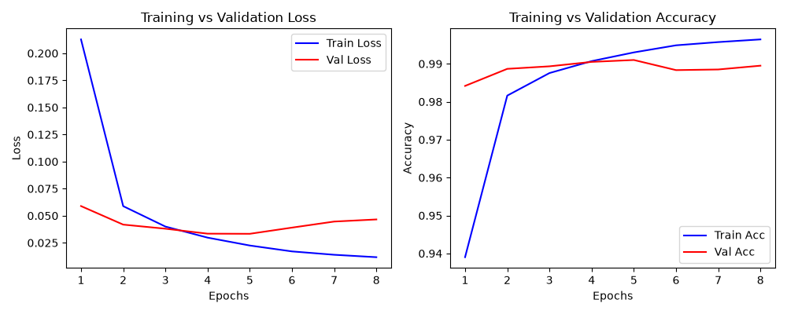

# MNIST 손글씨 숫자 인식 · 모델 서버와 화면 서버 분리

## 개요

- MNIST 손글씨 숫자 10종 분류 CNN 학습
- 화면에 숫자를 그려 예측 요청, 예측 숫자와 확률 출력
- GPU 모델 서버와 화면 서버 분리, 화면 서버는 모델 없이 HTTP로 예측 요청
- TensorFlow GPU 실행 환경을 Dockerfile로 구성
- 같은 PC 두 컨테이너 구성과 학교 VM 화면 서버 · GPU PC 모델 서버 구성 모두 실행 확인

## 사용 기술


## 동작 흐름

```text
브라우저 ── 그린 숫자 PNG, POST /predict ──▶ 화면 서버: webserver.py, 5000
                                               │  모델 없음
                                               └─ POST GPU_URL ──▶ 모델 서버: app.py, 8888, GPU
                                                                     │  전처리 → CNN 예측
◀──────────────── {"digit": 예측 숫자, "prob": 확률} ◀────────────────┘
```

- 화면 서버는 그림 파일을 받아 모델 서버로 그대로 전달
- 모델 서버는 시작할 때 모델을 한 번 불러오고 빈 입력으로 예측을 한 번 실행해 첫 요청 지연 감소
- 모델 서버 주소는 환경 변수 `GPU_URL`, 기본값 `http://host.docker.internal:8888/predict`

## 학습 결과



| 항목 | 내용 |
|---|---|
| 데이터 | MNIST 학습 60,000장 중 10% 검증, 테스트 10,000장 |
| 구조 | Conv 32 → MaxPool → Conv 64 → MaxPool → Dense 128 → Dense 10 softmax |
| 학습 | Adam, 배치 128, 최대 20 epoch |
| 저장 | 검증 정확도 최고 시점 가중치 저장, 검증 정확도가 3 epoch 동안 오르지 않으면 조기 종료 |
| 확인 | 화면에서 그린 숫자 10장 모두 정답 |

## 파일별 기능

- `train.py`: MNIST 학습, 학습 곡선 `history.png` 저장, 테스트 정확도 출력, 모델 `model.weights.h5` 저장
- `app.py`: 모델 서버, 모델 불러오기, `/predict` 예측, 8888 포트
- `webserver.py`: 화면 서버, `/predict` 요청을 모델 서버로 전달, 5000 포트
- `utils.py`: 흑백 변환, 색 반전, 28×28 맞춤, 0~1 정규화, 예측 결과를 숫자와 확률로 변환
- `templates/index.html`: 280×280 그림판, 지우기·예측하기 버튼, 결과 표시
- `Dockerfile`: Python 3.12, `tensorflow[and-cuda]` 설치, pip로 설치한 CUDA 라이브러리 경로를 `ldconfig`에 등록
- `model.weights.h5`: 학습한 모델, 구조와 가중치를 담은 HDF5 파일

## 프로젝트 구조

```text
tensorflow/
├─ Dockerfile
├─ train.py
├─ app.py
├─ webserver.py
├─ utils.py
├─ model.weights.h5
├─ history.png
├─ templates/
│  └─ index.html
└─ static/
   └─ style.css
```

## 문제 해결

| 구분 | 내용 |
|---|---|
| 문제 | `python:3.12-slim`에 `tensorflow[and-cuda]`를 설치해도 컨테이너에서 GPU 미인식 |
| 원인 | pip로 설치한 CUDA·cuDNN 공유 라이브러리가 `site-packages/nvidia/*/lib`에 있어 시스템 라이브러리 검색 경로 밖 |
| 해결 | 이미지 빌드 단계에서 해당 경로를 `/etc/ld.so.conf.d/`에 등록하고 `ldconfig` 실행 |
| 결과 | 컨테이너 시작마다 환경 변수를 설정하지 않고 GPU 사용 |

## 실행 방법

### 모델 서버

GPU PC, NVIDIA Container Toolkit 필요

```bash
cd tensorflow
docker build -t mnist-gpu .
docker run -it --gpus all -p 8888:8888 -v "$PWD":/workspace -w /workspace mnist-gpu
```

컨테이너 안에서 실행

```bash
pip install flask pillow
python app.py
```

`http://localhost:8888/`에서 화면과 예측을 한 서버로 바로 확인 가능

### 화면 서버

같은 PC 또는 다른 PC에서 실행

```bash
pip install flask requests
GPU_URL=http://<GPU PC IP>:8888/predict python webserver.py
```

브라우저 접속: `http://<화면 서버 IP>:5000/`

### 다시 학습

```bash
python train.py
```
